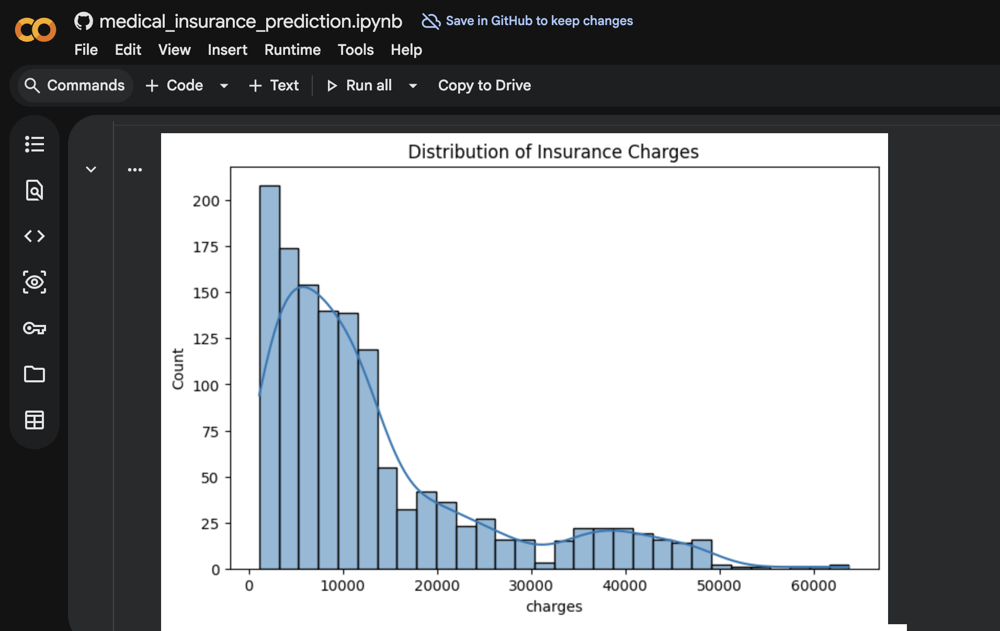
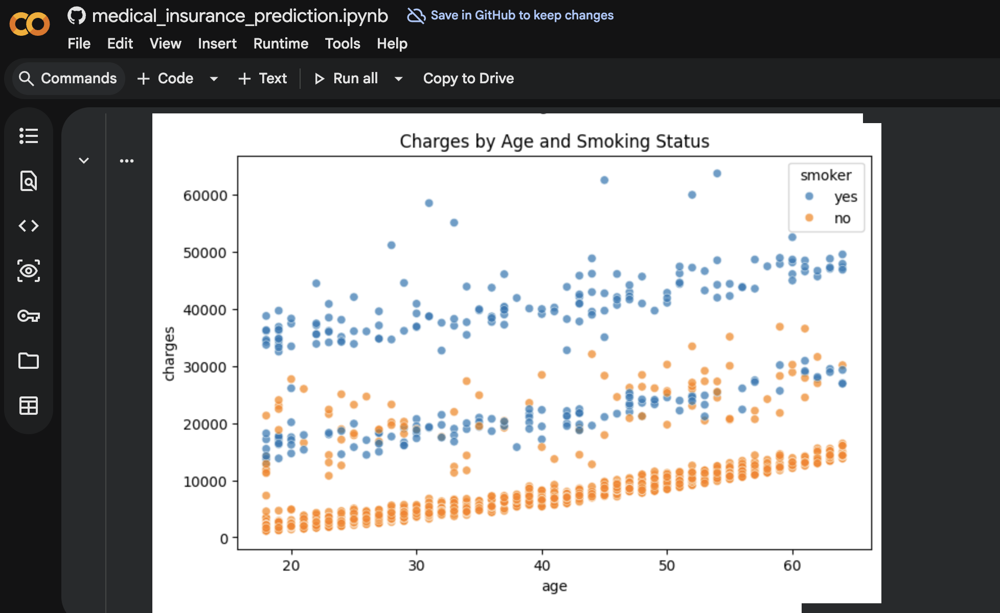
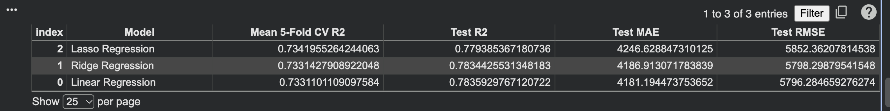

# Medical Insurance Cost Prediction

A Python regression project demonstrating data preparation, exploratory analysis, model training, and evaluation.

## Files
- `medical_insurance_prediction.ipynb` — complete Jupyter Notebook.
- `insurance.csv` — 1,338-row, 7-column dataset.
- `requirements.txt` — required Python packages.

## Technologies
Python, Pandas, NumPy, Matplotlib, Seaborn, Scikit-learn, Jupyter Notebook.

## Workflow
1. Load and inspect data.
2. Check missing values and duplicates.
3. Explore insurance charges with visualizations.
4. Preprocess numerical and categorical features.
5. Train Linear Regression, Ridge Regression, and Lasso Regression.
6. Compare using 5-fold cross-validation and test metrics.
7. Review predictions and make a sample prediction.

## Run
Install packages:
```bash
pip install -r requirements.txt
```
Open the notebook:
```bash
jupyter notebook medical_insurance_prediction.ipynb
```
Keep `insurance.csv` in the same folder as the notebook.

## Dataset notice
**Dataset Information**

This project uses a synthetic medical insurance dataset containing 1,338 records and 7 features for machine learning practice and model evaluation.

## Author
Harmanjit Singh Cheema


## Project Visualizations

### Insurance Charges Distribution


### Charges by Smoking Status


### Model Performance Comparison

